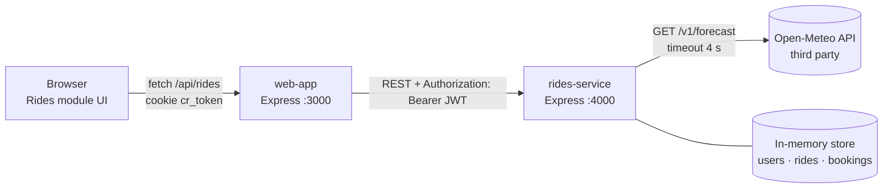

# CampusRide · Rides microservice (Unit 3 · Evidence 3)

CampusRide is a web app where students of the university share rides to campus.
This repository contains:

| Folder | What it is | Port |
|---|---|---|
| [`rides-service/`](rides-service) | **The microservice** (Node.js + Express). REST API to publish rides, book seats and get the weather forecast for each ride. Authentication with JWT. | 4000 |
| [`web-app/`](web-app) | **The main application**. Its *Rides* module consumes the microservice (server-side, the token is kept in an HttpOnly cookie). | 3000 |

The microservice consumes a **third-party API**, [Open-Meteo](https://open-meteo.com/en/docs) (free, no API key), to attach a weather forecast to every ride at its departure time and place.



---

## 1. Requirements

- **Node.js 20 or newer** (`node -v`). Nothing else: no database, no API keys.
- Internet access is only needed for the weather forecast. Without it, rides are still created and the weather shows as `unavailable`.

## 2. Install and run (3 commands)

```bash
git clone <this-repo-url> campusride
cd campusride
npm run setup     # installs both projects and creates both .env files with a random JWT_SECRET
npm start         # starts rides-service on :4000 and web-app on :3000 (Ctrl+C stops both)
```

Then open:

- Main app (Rides module): **http://localhost:3000**
- Microservice health check: **http://localhost:4000/api/v1/health** → `{"status":"ok", ...}`

<details>
<summary>Manual setup (if you prefer to do each step yourself, or <code>npm run setup</code> fails)</summary>

```bash
# 1. Microservice
cd rides-service
npm install
cp .env.example .env          # Windows CMD: copy .env.example .env
# edit .env and set JWT_SECRET to 32+ random characters, for example the output of:
node -e "console.log(require('crypto').randomBytes(48).toString('hex'))"
npm start                     # http://localhost:4000

# 2. Main web app (second terminal)
cd web-app
npm install
cp .env.example .env          # Windows CMD: copy .env.example .env
npm start                     # http://localhost:3000
```
</details>

### Demo accounts

Test data only — these are not real people or real passwords. Passwords are stored as bcrypt hashes in `rides-service/src/data/store.js`.

| Email | Password | Role |
|---|---|---|
| ana@campusride.test | `Driver123!` | driver (owns rides 1 and 2) |
| luis@campusride.test | `Rider123!` | student |
| sofia@campusride.test | `Rider456!` | student (already booked ride 2) |

Data lives in memory, so it resets every time the service restarts.

## 3. Environment variables

`.env` files are **not** in the repository (see `.gitignore`). Each project has a `.env.example`.

**rides-service/.env**

| Variable | Example | Description |
|---|---|---|
| `PORT` | `4000` | Port of the microservice |
| `JWT_SECRET` | *(64+ random hex chars)* | **Secret** to sign tokens (HS256). Required, min. 32 characters; the service refuses to start without it |
| `JWT_EXPIRES_IN` | `15m` | Access token lifetime |
| `CORS_ORIGIN` | `http://localhost:3000` | Origin allowed by CORS |
| `WEATHER_API_URL` | `https://api.open-meteo.com/v1/forecast` | Third-party API base URL |
| `WEATHER_TIMEOUT_MS` | `4000` | Max wait for Open-Meteo |
| `LOGIN_RATE_LIMIT` | `10` | Login attempts allowed per IP every 15 minutes |

**web-app/.env**

| Variable | Example | Description |
|---|---|---|
| `PORT` | `3000` | Port of the main app |
| `RIDES_SERVICE_URL` | `http://localhost:4000/api/v1` | Base URL of the microservice |
| `RIDES_SERVICE_TIMEOUT_MS` | `8000` | Max wait for the microservice |
| `COOKIE_SECURE` | `false` | `true` in production (HTTPS only cookie) |

## 4. Endpoints

Base URL: `http://localhost:4000/api/v1` · All bodies are JSON · 🔒 = requires `Authorization: Bearer <accessToken>`

| Method | Endpoint | Auth | Input | Success | Errors |
|---|---|---|---|---|---|
| GET | `/health` | — | — | `200 { status, service, time }` | — |
| POST | `/auth/login` | — | `{ email, password }` | `200 { accessToken, tokenType, expiresIn, user }` | 400, 401, 429 |
| GET | `/auth/me` | 🔒 | — | `200 { user }` | 401 |
| GET | `/rides` | — | query `?date=YYYY-MM-DD&available=true\|false&destination=text` (all optional) | `200 [ ride ]` | 400 |
| GET | `/rides/:id` | — | — | `200 ride` | 400, 404 |
| POST | `/rides` | 🔒 | `{ origin: { name, lat, lng }, destination, departureTime, seats, pricePerSeat }` | `201 ride` + `Location` header | 400, 401 |
| DELETE | `/rides/:id` | 🔒 (driver of the ride) | — | `204` (no body) | 400, 401, 403, 404 |
| POST | `/rides/:id/bookings` | 🔒 | — | `201 { id, rideId, passengerId, createdAt, seatsAvailable }` | 400, 401, 404, 409 |
| GET | `/bookings` | 🔒 | — | `200 [ { id, createdAt, ride } ]` (only yours) | 401 |
| GET | `/rides/:id/weather` | — | — | `200 forecast` (live from Open-Meteo) | 400, 404, 503 |

**Validation rules for `POST /rides`:** `origin.name` 3–120 chars · `origin.lat` −90..90 · `origin.lng` −180..180 · `destination` 3–120 chars · `departureTime` ISO 8601 with timezone (`2026-11-10T07:30:00-06:00`) and in the future · `seats` integer 1–6 · `pricePerSeat` 0–500 (MXN).

**Business rules (409 Conflict):** you cannot book your own ride, book the same ride twice, book a full ride, or book a ride that already departed.

<details>
<summary>Example: ride object</summary>

```json
{
  "id": 3,
  "driver": { "id": "u1", "name": "Ana Torres" },
  "origin": { "name": "Jardín Guerrero", "lat": 20.5925, "lng": -100.3938 },
  "destination": "Main campus",
  "departureTime": "2026-11-10T13:30:00.000Z",
  "seatsTotal": 3,
  "seatsAvailable": 3,
  "pricePerSeat": 20,
  "weather": {
    "status": "ok",
    "forecastFor": "2026-11-10T13:00Z",
    "temperatureC": 14.2,
    "precipitationProbability": 5,
    "description": "Mainly clear",
    "source": "open-meteo.com"
  },
  "createdAt": "2026-11-05T23:10:00.000Z"
}
```
</details>

### Error format

Every error is JSON with the same shape. Stack traces and internal details are **never** sent to the client (they are only logged on the server).

```json
{
  "error": {
    "code": "VALIDATION_ERROR",
    "message": "Invalid request data",
    "details": [
      { "field": "seats", "message": "seats must be an integer between 1 and 6" }
    ]
  }
}
```

| Code | HTTP | When |
|---|---|---|
| `VALIDATION_ERROR` | 400 | Invalid body, query or id |
| `INVALID_JSON` | 400 | Body is not valid JSON |
| `UNAUTHORIZED` | 401 | Missing, malformed, modified or expired token; wrong credentials |
| `FORBIDDEN` | 403 | Authenticated but not the owner of the ride |
| `NOT_FOUND` | 404 | Ride or route does not exist |
| `CONFLICT` | 409 | Booking rule broken |
| `TOO_MANY_REQUESTS` | 429 | Too many login attempts |
| `WEATHER_UNAVAILABLE` | 503 | Open-Meteo failed on `GET /rides/:id/weather` |
| `INTERNAL_ERROR` | 500 | Unexpected error (generic message only) |

## 5. Third-party API: Open-Meteo (with error handling)

`rides-service/src/services/weather.js` calls `GET https://api.open-meteo.com/v1/forecast` from the **backend** with the ride's origin coordinates and departure date, and picks the hour of departure.

| Failure | What the service does |
|---|---|
| Open-Meteo does not answer in `WEATHER_TIMEOUT_MS` | Aborts the request; `weather = { status: "unavailable", reason: "Weather provider timed out" }` |
| Network error / DNS / no internet | `weather.status = "unavailable"`, reason "Weather provider is unreachable" |
| HTTP 4xx/5xx from Open-Meteo | `weather.status = "unavailable"`, reason includes the HTTP status |
| Invalid JSON or missing hour | `weather.status = "unavailable"` |
| Departure more than 15 days ahead | Does not call the API (Open-Meteo forecasts only ~16 days) |

**Publishing a ride never fails because of the weather** (graceful degradation: `201` with `weather.status = "unavailable"`). The explicit refresh endpoint `GET /rides/:id/weather` returns `503 WEATHER_UNAVAILABLE` so the client knows the forecast could not be updated.

## 6. How the main app consumes the microservice

`web-app/server.js` is the backend of the main application. Its **Rides module** (`web-app/public/app.js`) lets users browse rides, log in, publish rides, book seats, cancel their rides and see their bookings.

1. `POST /session` → forwards to `POST /auth/login`; the JWT is stored in an **HttpOnly, SameSite=Strict** cookie (JavaScript in the browser cannot read it).
2. `/api/rides…` and `/api/bookings` → forwarded to the microservice with `Authorization: Bearer <token>` taken from the cookie.
3. If the microservice is down, the web app answers `503 SERVICE_UNAVAILABLE` with a clear message instead of crashing.

## 7. Proof that it works

### Automated tests (32 tests)

```bash
npm test          # from the repository root (or: cd rides-service && npm test)
```

They cover every endpoint and status code (200/201/204/400/401/403/404/409/503), missing / modified / expired / `alg: none` tokens, malformed JSON, and every failure mode of the third-party API (the API is mocked so tests do not need internet).

### Request collection

[`rides-service/requests.http`](rides-service/requests.http) — 25 requests with the expected status written above each one. Open it in VS Code with the **REST Client** extension and click *Send Request* (requests 2 and 3 log in and store the tokens for the rest).

### Quick check with curl

```bash
curl http://localhost:4000/api/v1/rides
curl -X POST http://localhost:4000/api/v1/auth/login -H "Content-Type: application/json" \
     -d '{"email":"luis@campusride.test","password":"Rider123!"}'
curl -X POST http://localhost:4000/api/v1/rides/1/bookings -H "Authorization: Bearer <accessToken>"
```

## 8. Security measures

- JWT signed with HS256, algorithm pinned in `verify()`, issuer checked, 15-minute expiry. Payload has only `sub` (user id) and `role` — no personal data.
- Passwords stored as bcrypt hashes; same message for unknown email and wrong password.
- Rate limit on `/auth/login`.
- Secrets only in `.env` (ignored by git); `.env.example` documents them. The service refuses to start without a strong `JWT_SECRET`.
- `helmet` security headers, CORS restricted to the web app origin, JSON body limited to 10 kB.
- Central error handler: generic messages to the client, details only in server logs.
- Frontend renders all data with `textContent` (no `innerHTML`) to avoid XSS.
- In production: serve both apps over HTTPS and set `COOKIE_SECURE=true`.

## 9. Project structure

```
campusride/
├── package.json            # root scripts: setup, start, test
├── scripts/                # setup-env.js (creates .env files), start-all.js
├── rides-service/          # THE MICROSERVICE
│   ├── .env.example
│   ├── requests.http       # request collection
│   ├── src/
│   │   ├── server.js · app.js · config.js · errors.js · validation.js
│   │   ├── routes/         # auth.js · rides.js · bookings.js
│   │   ├── middleware/     # auth.js (JWT) · errorHandler.js · asyncHandler.js
│   │   ├── services/       # weather.js (Open-Meteo client)
│   │   └── data/store.js   # in-memory data + demo users
│   └── test/               # api.test.js · weather.test.js
└── web-app/                # MAIN APP (Rides module consumes the microservice)
    ├── .env.example
    ├── server.js
    └── public/             # index.html · app.js · styles.css
```

## 10. Evidence 3 checklist map

| # | Indicator | Where to check |
|---|---|---|
| 1–2 | README and start-up | Sections 1–2 (`npm run setup` → `npm start`) |
| 3 | ≥ 3 endpoints, resource URLs, correct verbs | Section 4 (9 endpoints + health) |
| 4 | Status codes | Section 4 tables; `test/api.test.js` |
| 5 | Validation → 400 JSON | `src/validation.js`; requests 5, 6, 10, 13, 17 |
| 6 | Protected endpoints | `src/middleware/auth.js`; requests 14, 15 |
| 7 | Secrets in env, `.env` not committed | `.gitignore`, both `.env.example` |
| 8 | No stack traces | `src/middleware/errorHandler.js`; request 6 |
| 9 | Third-party API with error handling | Section 5; `src/services/weather.js`; `test/weather.test.js` |
| 10 | Main app consumes the microservice | Section 6; `web-app/server.js`, http://localhost:3000 |
| 11 | Tests / request collection | Section 7 |
| 12 | Contributions | Git history |

## Team

| Member | Contribution |
|---|---|
| _Name 1_ | _e.g. auth + JWT middleware_ |
| _Name 2_ | _e.g. rides and bookings endpoints_ |
| _Name 3_ | _e.g. Open-Meteo client + tests_ |
| _Name 4_ | _e.g. web-app Rides module + README_ |
